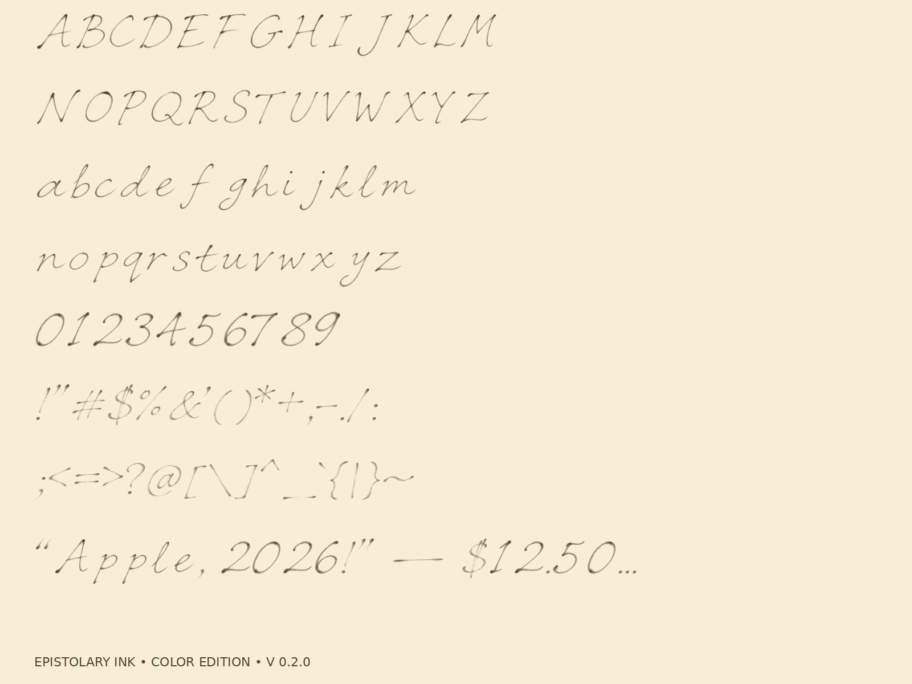

# Epistolary Ink

A delicate, ink-washed handwritten typeface inspired by archival letters and fountain-pen writing.



## Download

| Edition | Desktop | Web |
|---|---|---|
| Color — layered, translucent sepia ink | [TTF](fonts/EpistolaryInk-Color.ttf) | [WOFF2](fonts/EpistolaryInk-Color.woff2) |
| Regular — monochrome, recolorable outlines | [TTF](fonts/EpistolaryInk-Regular.ttf) | [WOFF2](fonts/EpistolaryInk-Regular.woff2) |

Version **0.2.0** covers all 95 printable ASCII characters: uppercase A–Z, lowercase a–z, numerals 0–9, 32 punctuation marks, and space. It also includes smart quotes, en/em dashes, a minus sign, and an ellipsis (103 characters total). Accented characters and alternate glyphs are planned for future versions. The Color edition relies on OpenType COLR/CPAL support; use the Regular edition where color fonts are not supported.

## Web use

Download the WOFF2 font into your project and use:

```css
@font-face {
  font-family: 'Epistolary Ink Color';
  src: url('./fonts/EpistolaryInk-Color.woff2') format('woff2');
  font-display: swap;
}

.handwritten { font-family: 'Epistolary Ink Color', cursive; }
```

## Build from source

```sh
pip install -r requirements.txt
python build_font.py
```

The source density sheets store the ink coverage for the letters, numerals and punctuation. The builder traces the outlines and creates six overlapping translucent ink layers for the Color edition.

## License

Copyright 2026 Wenyi Ye. Licensed under the [SIL Open Font License 1.1](OFL.txt). Free for personal and commercial use, subject to the license terms.
